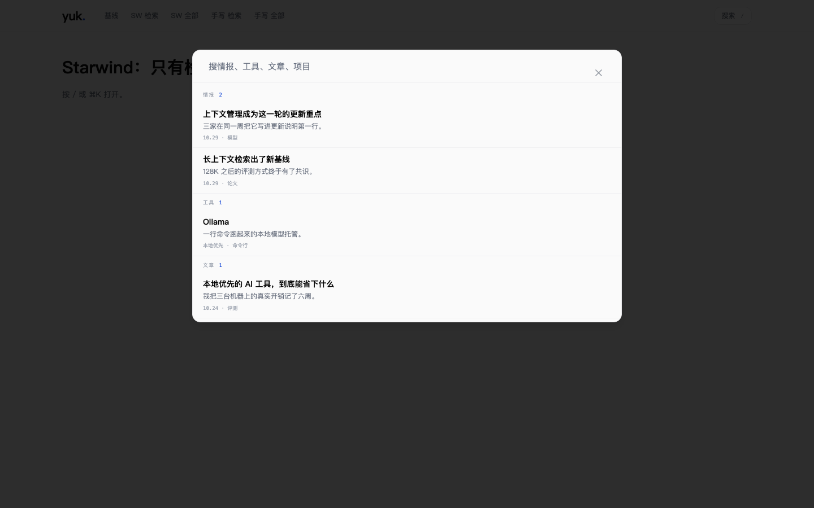
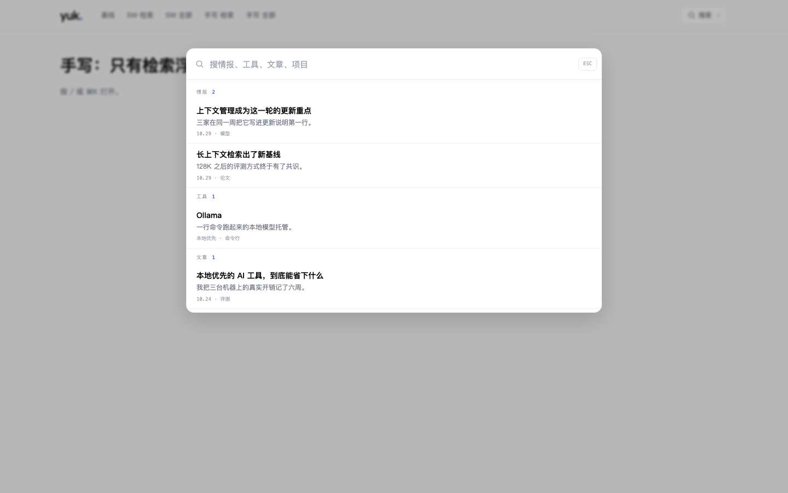
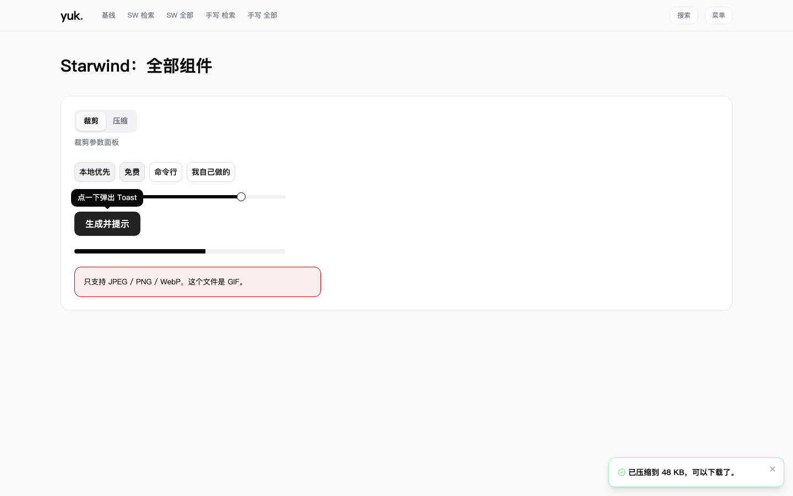
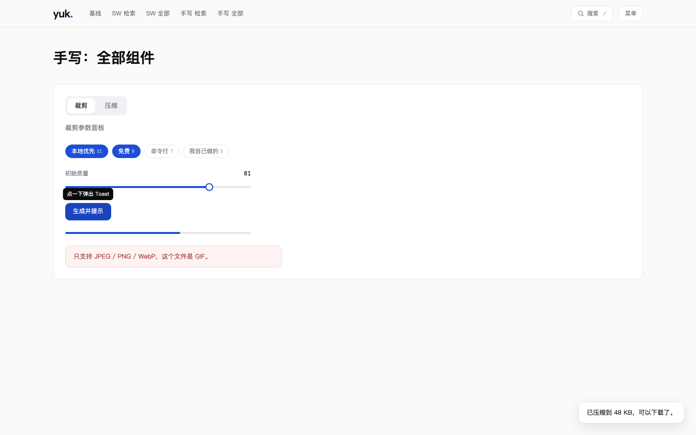

# 个人网站 v5 改版：组件方案验证

## 结论

推荐**基于 Tailwind 手写组件**，Starwind UI 先不装。

- **体积**：所有页面都需要检索浮层。用 Starwind 实现，每个页面要多加载 12.1 KB（gzip，下同）的 JS；手写只多 0.4 KB。
- **效果**：两套方案用的是同一套设计令牌，改到最后看起来一样。但 Starwind 的默认样式是 shadcn 风格：主按钮黑色、chips 选中后是灰色、遮罩黑色 80%。要贴合设计稿，得把每个组件的 `variants.ts` 都改一遍，"拿来就好看"的优势在这套设计里基本用不上。
- **行为**：手写版补上焦点约束（约 15 行代码）之后，20 项交互和无障碍检查全部通过。Starwind 也全部通过，只有 Tabs 一处行为不同（见下文）。
- **按需加载**：Starwind 确实可以按组件加载，没用到的组件不产生任何 JS。以后如果需要 Combobox、Select、Popover 这类复杂组件，可以单独引入，和手写组件共存。

## 验证方法

在 `/tmp/sw-spike` 新建了一个和仓库同版本的项目：Astro 7.0.7、Tailwind 4.3.3、`@tailwindcss/vite` 4.3.3、ClientRouter 视图过渡。

- 用 `starwind@3.4.1 init` 初始化，再添加 11 个组件：dialog、sheet、tabs、slider、button、input、toggle、tooltip、alert、progress、toast。
- 用同一套设计令牌手写同样的组件：原生 `<dialog>`、WAI-ARIA tablist、原生 range、`aria-pressed` 按钮、CSS tooltip、自写 toast。
- 做了 5 个页面：基线页（只有 Tailwind 和顶栏）、两套方案各一个"只有检索浮层"页、两套方案各一个"全部组件"页。
- 体积统计：从构建产物 HTML 出发，沿静态 import 链把这个页面实际加载的文件全部找出来，按 gzip level 9 计算。
- 交互测试：用 Playwright 加本机 Chromium 跑 20 项检查。

Starwind 在 Astro 7 下的兼容性：`pnpm build` 通过，浏览器里没有 JS 报错，组件经过 ClientRouter 页面切换后仍能正常工作。

## 体积

### 各页面实际加载量

| 页面 | JS（gzip） | CSS（gzip） | 比基线多出的 JS |
|---|---|---|---|
| 基线（Tailwind + 顶栏 + ClientRouter） | 6.0 KB | 8.0 KB | — |
| 手写：检索浮层 | 6.4 KB | 8.1 KB | +0.4 KB |
| Starwind：检索浮层 | 18.5 KB | 11.0 KB | +12.5 KB |
| 手写：全部组件 | 7.3 KB | 8.1 KB | +1.3 KB |
| Starwind：全部组件 | 64.6 KB | 11.4 KB | +58.6 KB |

基线里的 6.0 KB 基本都是 ClientRouter。Starwind 页面的 CSS 多出约 3 KB，来自 `tw-animate-css`、`@tailwindcss/forms` 和主题变量。这部分是全局的，装了 Starwind 之后每个页面都会带上。

### Starwind 单个组件的 JS（gzip，含约 0.5 KB 的共享生命周期代码）

| 组件 | 体积 | 本站用在哪 |
|---|---|---|
| Button | 2.0 KB | 浮层里的关闭按钮也依赖它 |
| Progress | 3.0 KB | 图片治理 |
| Toggle | 3.7 KB | chips |
| Toast 容器 | 6.0 KB | 图片治理 |
| 调用 `toast()` 的接口 | 约 13 KB | 图片治理 |
| Tabs | 7.3 KB | 图片治理 |
| Slider | 7.6 KB | 图片治理 |
| Dialog | 11.7 KB | **每个页面**（检索浮层） |
| Sheet（内部用的是 Drawer） | 12.3 KB | **每个页面**（移动端导航） |
| Tooltip | 17.8 KB | 图片治理（带碰撞检测定位） |

几个问题的回答：

- **大不大**：装在磁盘上的运行时约 1.5 MB，但打包时只会带进用到的模块。
- **能不能按需加载**：能。组件脚本按页面打包，页面没用到就不会加载。`tailwind-variants` 和 `tailwind-merge` 只在构建时运行，不进入浏览器。`@tabler/icons` 只打包实际引用的那几个 SVG。
- **新增的依赖**：`@starwind-ui/astro`、`@tabler/icons`、`@tailwindcss/forms`、`tailwind-merge`、`tailwind-variants`、`tw-animate-css`。

## 交互与无障碍

| 检查项 | Starwind | 手写 |
|---|---|---|
| 点击打开检索浮层，输入框自动获得焦点 | ✓ | ✓ |
| Tab 焦点不离开浮层 | ✓ | ✓（需要补约 15 行；原生 modal 会把焦点交给浏览器地址栏） |
| 浮层打开时背景不能滚动 | ✓ | ✓ |
| ↑↓ 选择结果、Esc 关闭、关闭后焦点回到触发按钮 | ✓ | ✓ |
| 按 `/` 打开、点击遮罩关闭 | ✓ | ✓ |
| 页面切换回来后仍能打开，且没有重复绑定 | ✓ | ✓ |
| Tabs：点击切换，方向键移动焦点 | ✓ | ✓ |
| Tabs：方向键直接切换内容 | 需要再按 Enter（手动激活模式） | ✓（自动激活） |
| Slider 方向键调整、Toggle 切换、Tooltip 悬停出现、Toast 弹出 | ✓ | ✓ |
| Sheet 打开、Esc 关闭 | ✓ | ✓ |
| 无 JS 报错 | ✓ | ✓ |

两种 Tabs 激活方式都符合 WAI-ARIA 规范。对图片治理只有两个标签的场景来说，自动激活更直接。

手写方案利用了原生 `<dialog>` 的 `showModal()`：浏览器会自动把背景设为 inert，自动处理 Esc 关闭，并在关闭后把焦点还给触发按钮。进出场动画用 `@starting-style` 加 `transition-behavior: allow-discrete`，完全不需要 JS。

## 视觉

两套方案都只改了主题变量，没有逐个组件精修。

Starwind 的默认样式和设计稿不一致的地方：

- 遮罩是黑色 80%，设计要求 28% 加 2px 模糊。
- 浮层底色跟着 `--background` 变成 `#FAFAFA`，设计要求纯白。
- 主按钮、Slider、Progress 用的是前景色（黑色）。
- chips 选中后是灰底，设计要求蓝底白字。
- 错误提示是红色实线框。

这些都能改，因为组件源码就在我们的项目里，但每个组件都要动 `variants.ts`。工作量和手写差不多，改完的代码却比手写版多出一层抽象。

Starwind 做得更好的地方：

- Tooltip 有碰撞检测，靠近屏幕边缘时会自动换方向。
- Toast 支持堆叠、滑动关闭、Promise 状态和多种类型。
- 嵌套浮层、RTL 等边界情况都处理过。

本站目前用不到这些能力。

## 对落地方案的影响

如果确定手写，`2026-10-29-个人网站v5改版-落地方案.md` 需要相应调整：

- 6.2 节：组件库从 Starwind 改为基于 Tailwind 手写。组件放在 `src/components/ui/`，包括 Dialog、Sheet、Tabs、Toggle、Slider、Tooltip、Toast、Progress、Alert，都按 WAI-ARIA 模式实现。本次验证写的代码可以直接作为起点。
- 不再引入 `@tailwindcss/forms` 和 `tw-animate-css`，动效仍按 6.3 节，由 GSAP 和原生 CSS 负责。
- 第 8 节的依赖清单里去掉 Starwind 相关的包。
- 风险表里"Starwind 与 Astro 7 兼容性未验证"这一条删掉。保留一条约定：以后需要 Combobox 这类复杂组件时，单独评估是否引入 Starwind 的对应组件。
