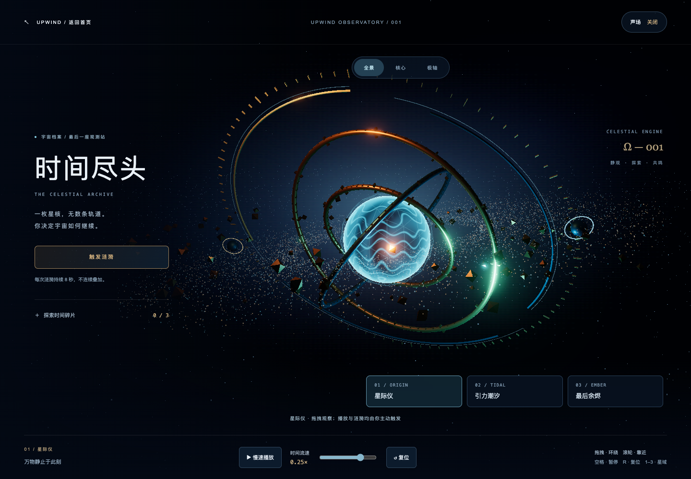
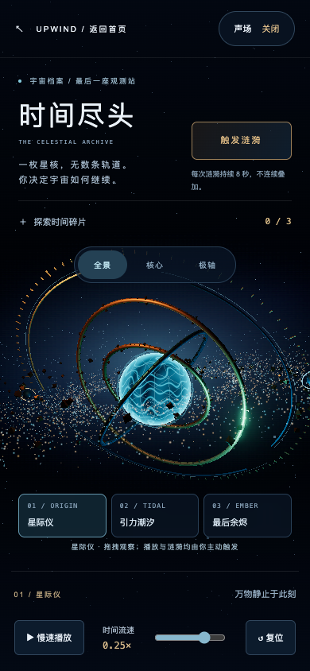

# 时间尽头：首页视觉扩展

本次交付将首页首屏升级为可交互的三维星际仪，并新增 `/end-of-time` 完整探索页。两处复用 `createCelestial()` 的能量核心、金属材质、三重星环和粒子盘，完整页通过 `observatory.ts` 扩展全屏空间。首页保留搜索与内容导航，移除重复的「我做的」作品展示区。

## 视觉与交互

- 蓝色电离核心、铜金环线、冷暖照明与深蓝背景，与首页同源。
- 扩展外围分段轨道、刻度、两枚观测卫星、稀疏纵深星流与远处星云，提供不同距离的遮挡和空间层次。
- 完整页适度收敛核心与粒子的高亮输出；Bloom 固定，不随操作连续增亮。
- 增加全景、核心、极轴三个视角，1.8 秒平滑过渡；用户拖拽立即取消过渡并接管镜头。减少动态效果时直接切换。
- 保留默认静止、0.25× 主动播放、±0.5× 流速范围、复位暂停、8 秒单次涟漪、可选碎片任务。
- 手机调整标题、动作按钮、视角切换、阶段选择和底部时间控制的位置，避免文字相互遮挡。

## 验收

- `pnpm check`：0 errors、0 warnings，5 个原有 hints。
- `pnpm build`：17 页构建成功。
- 14 项浏览器测试全部通过：静止画面逐字节稳定、慢速播放/倒流/复位、手机布局、减少动态效果、WebGL 降级、首页搜索与往返、首页交互、两种尺寸任务闭环、核心高亮面积、涟漪防叠加、视角切换与拖拽接管。
- 桌面全景、近距离核心视角与手机布局实景复查；手机按钮与说明文字重叠已修复。
- `git diff --check` 通过。未发布线上，未做实体手机帧率测试。

## 提交前复核（2026-11-10）

本次只提交最终页面代码、依赖、测试、本文件和两张实景图；已有情报页、内容配置、feed:pull 脚本及中间方案文件未混入提交。

从暂存索引导出的独立副本完成验收：69 个单元测试通过、14 项浏览器回归通过、类型检查和 17 页静态构建通过。修复任务 summary 的空格操作被全局快捷键拦截、方向键不能打断镜头过渡，以及退出系统减少动态效果后自动播放的问题。默认静止状态改为按需绘制，降低无交互时的 GPU 消耗。
